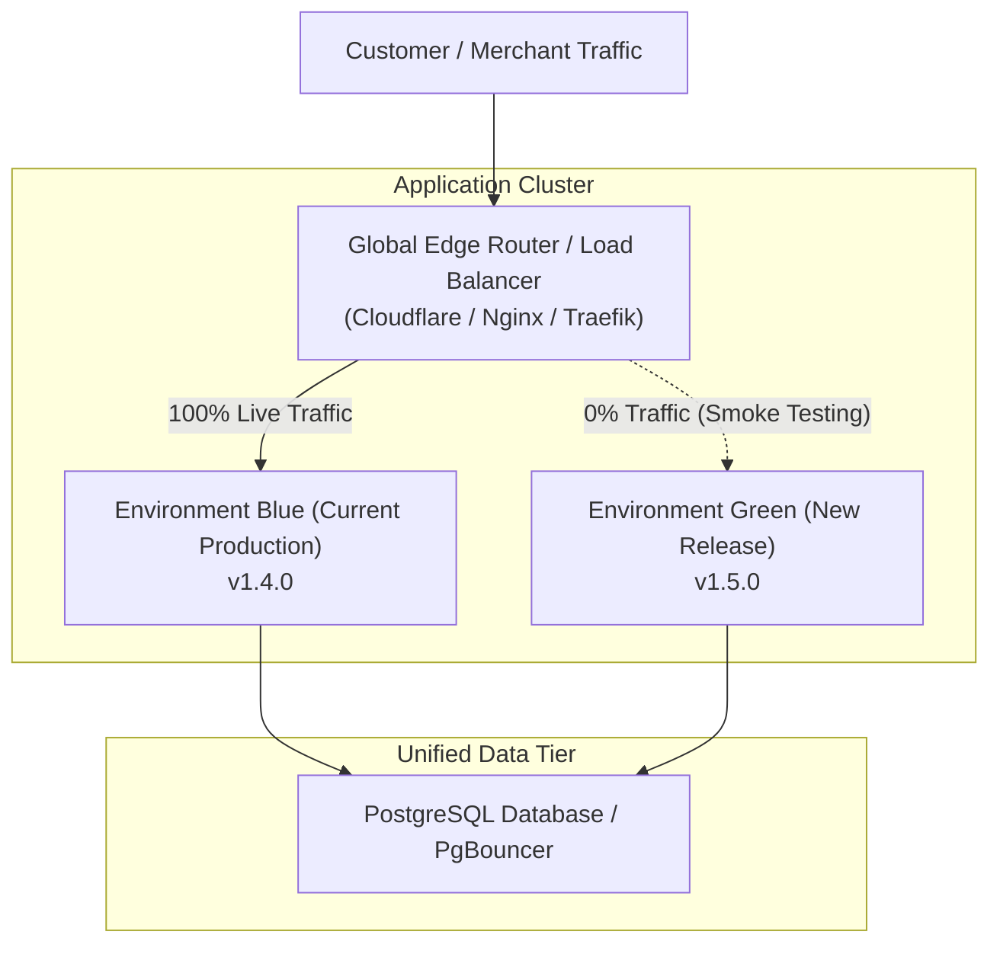
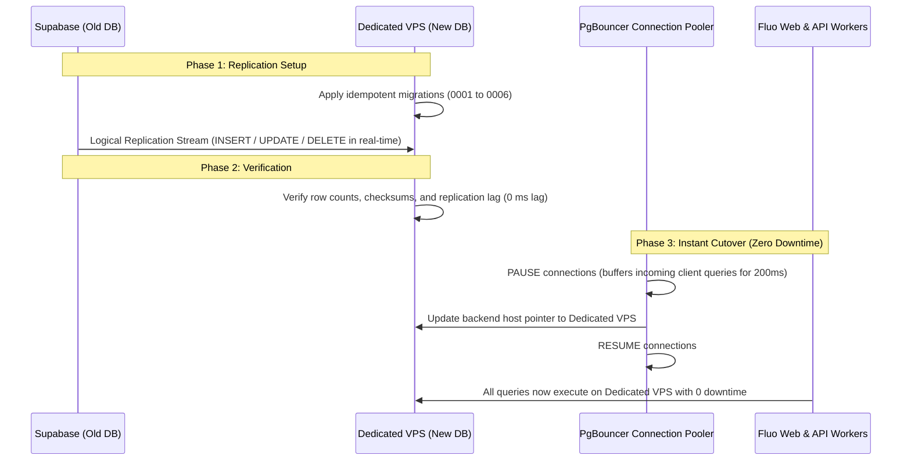

# Fluo Enterprise Scaling, Architecture & Operations Manual

This document serves as the permanent source of reference, operational guidance, and architectural blueprint for scaling Fluo from its initial campus launch through millions of daily transactions across Nigeria and Africa.

---

## 1. Zero-Downtime Deployments & Safe Migrations

### 1.1 The Blue-Green Deployment Architecture
The pattern where two identical production environments run side-by-side:



#### How it works:
1. **Blue** is live, serving 100% of user traffic.
2. When deploying an update, deploy the new build to **Green** (identical isolated cluster or container set).
3. **Automated Smoke Tests**: Synthetic checks hit Green (health endpoints, test queries, pricing validation).
4. **Instant Switchover**: The edge router (Cloudflare, Nginx, or Traefik) atomically switches traffic from Blue to Green in milliseconds.
5. **Instant Rollback**: If application error rates spike or an unexpected issue occurs, the router flips back to Blue with zero user impact while the team inspects Green.
6. Once Green is proven stable, Blue is shut down or becomes the staging target for the next release.

---

### 1.2 Zero-Downtime Database Migration: Supabase $\rightarrow$ Dedicated VPS

Fluo was deliberately engineered with **zero proprietary Supabase dependencies**. All queries in `PgStore` are pure, standard parameterised PostgreSQL. This allows transitioning off Supabase to your own self-hosted PostgreSQL cluster on a high-performance VPS (e.g., Hetzner, DigitalOcean, AWS) without dropping a single active transaction.



#### Step-by-Step Migration Playbook:
1. **Provision VPS**: Ubuntu 24.04 LTS, NVMe SSD storage, PostgreSQL 16+, PgBouncer.
2. **Apply Idempotent Schema**: Run Fluo migrations `database/migrations/*.sql` on the target VPS. Every migration file is strictly idempotent (`create table if not exists`, `create index if not exists`).
3. **Logical Replication**:
   - On Supabase: `CREATE PUBLICATION fluo_pub FOR ALL TABLES;`
   - On VPS: `CREATE SUBSCRIPTION fluo_sub CONNECTION 'postgres://...' PUBLICATION fluo_pub;`
   - Supabase continuously streams every change to the VPS in real time.
4. **Traffic Cutover**: Update your app's `DATABASE_URL` or point PgBouncer to the VPS using Blue-Green deployment. Total downtime: 0 seconds.

---

## 2. Realistic Sizing, Capacity & Benchmarks

| Metric / Stage | Supabase Free | Supabase Pro ($25/mo) | Dedicated VPS ($50-$80/mo) |
| :--- | :--- | :--- | :--- |
| **Compute Profile** | Shared 2-core, ~1GB RAM | Dedicated 2+ cores, auto-scaling | 8-16 Dedicated Cores, 32-64GB RAM |
| **Storage Limit** | 500 MB | 8 GB (auto-expanding) | 500 GB - 2 TB NVMe Gen4 SSD |
| **Concurrent Users** | 50 - 150 active | 500 - 2,500 active | 15,000+ active concurrent |
| **Orders / Transactions** | ~10,000 / month | ~300,000 / month | 10,000,000+ / month |
| **Database Connections** | ~60 direct, ~200 pooler | 1,000+ via Supavisor | 10,000+ via PgBouncer |
| **Cache Efficiency** | RAM buffer ~256MB | RAM buffer 1GB - 8GB | Full hot dataset cached in RAM |
| **When to Upgrade** | Move to Pro when hitting 300+ daily orders or 400MB storage | Move to Dedicated VPS when database exceeds 50GB or Pro add-ons exceed $150/mo | Unlimited scale on fixed monthly hosting cost |

---

## 3. Strict Codebase Modularity & Directory Reference

To keep Fluo maintainable as an enterprise platform serving millions of users, every capability has a single, isolated source file:

```
fluo/
├── packages/
│   ├── core/                      # Pure business domain logic (Zero DB or framework imports)
│   │   ├── src/
│   │   │   ├── billing/          # Pricing plans, subscriptions, tax, overage calculation
│   │   │   │   ├── plans.ts      # 4-tier pricing (Free, Starter, Growth, Business, Pro)
│   │   │   │   ├── pricing.ts    # Price book and currency conversion
│   │   │   │   └── trial.ts      # 30-day free trial logic
│   │   │   ├── commerce/         # Shopping cart, catalogue, orders, tickets
│   │   │   ├── mobility/         # Keke, bike, and vehicle rides + fare negotiation
│   │   │   │   └── rides.ts      # State machine, GPS distance, counter-offers, dispatch bridge
│   │   │   ├── notifications/    # Email, push templates, and budget rules
│   │   │   ├── platform/         # Authz permissions, operating hours, timezone logic
│   │   │   │   ├── operating-hours.ts  # Weekly business schedules and "Open Now" badges
│   │   │   │   └── capabilities.ts     # Capabilities registry (orders, bookings, rides, etc.)
│   │   │   └── services/         # Domain use-cases (checkout, staff, messaging, etc.)
│   │   │       ├── checkout-service.ts # Order placement & payment confirmation
│   │   │       ├── lifecycle.ts        # Order-paid hooks & usage ledger alerts
│   │   │       └── ports.ts            # Store, Email, Push, and Storage interfaces
│   ├── db/                        # Database implementations & migrations
│   │   ├── src/
│   │   │   ├── pg-store.ts       # PostgreSQL Store implementation
│   │   │   ├── memory-store.ts   # In-memory Store for tests & dev fallback
│   │   │   └── pool.ts           # Connection pooling configuration
│   └── adapters/                  # External 3rd party providers (Each in its own file)
│       ├── src/
│       │   ├── paystack.ts       # Paystack payment provider & webhooks
│       │   ├── email.ts          # Resend & Gmail SMTP provider
│       │   ├── expo-push.ts      # Expo Mobile Push Notifications
│       │   ├── r2.ts             # Cloudflare R2 / AWS S3 image storage
│       │   └── ai.ts             # Pluggable AI / LLM provider for catalogue & dispatch
└── apps/
    ├── web/                       # Next.js Fullstack Progressive Web App (PWA)
    │   ├── public/
    │   │   ├── icon.svg          # App icon
    │   │   └── sw.js             # Service Worker for offline caching & installability
    │   └── src/
    │       ├── app/
    │       │   ├── manifest.ts   # PWA Web Manifest (name, colors, standalone mode)
    │       │   ├── actions.ts    # Server Actions (Cart checkout, rides, bookings)
    │       │   └── layout.tsx    # Root layout with InstallPrompt banner
    │       └── components/
    │           └── install-prompt.tsx # PWA install prompt banner component
```

---

## 4. Progressive Feature Roadmap (Next Capabilities)

These features build naturally on Fluo's existing universal primitives:

1. **WhatsApp Commerce Bot (`packages/adapters/src/whatsapp.ts`)**:
   - Webhook bridge: merchants can receive order notifications and reply to customer inquiries directly via WhatsApp.
2. **Escrow QR Delivery Handoff**:
   - When a rider delivers a bakery or supermarket order, the customer reveals their order QR code; the rider scans it, automatically releasing settlement to the store and rider.
3. **POS Kiosk Mode & Bluetooth Receipt Printer**:
   - For fast food, provision stores, and campus events, enabling 1-click cash/transfer recording with 58mm thermal receipt printing.
4. **Group Cart / Split Payment**:
   - Campus roommates or event attendees can share a cart link to add items and contribute individual shares before dispatch.
5. **Campus Student & Staff Verification**:
   - Integration with university portals to grant verified student badges, student discounts, and campus security gate clearance.

---

## 5. How to Run & Test Fluo

### 5.1 Run the Full Automated Test Suite
From the project root:
```bash
npm test
```
*Executes all 165+ tests covering billing calculations, concurrency locks, stock reservations, ticket admissions, rides negotiation, and store contracts.*

### 5.2 Run the Web Application
1. Configure environment variables in `apps/web/.env.local` (copy from `apps/web/.env.example`).
2. Run database migrations:
   ```bash
   npm run migrate --filter @fluo/db
   ```
3. Start the Next.js development server:
   ```bash
   npm run dev --filter web
   ```
4. Open [http://localhost:3000](http://localhost:3000) in your browser.

### 5.3 Install as a Progressive Web App (PWA)
- **On Android (Chrome / Brave)**: Open the web app. The native **"Install Fluo App"** prompt appears automatically at the top of the screen. Tap **Install** to add Fluo to the home screen.
- **On iOS (Safari)**: Tap the Share button $\rightarrow$ select **"Add to Home Screen"**.
- **On Desktop (Chrome / Edge)**: Click the Install icon in the browser address bar.
