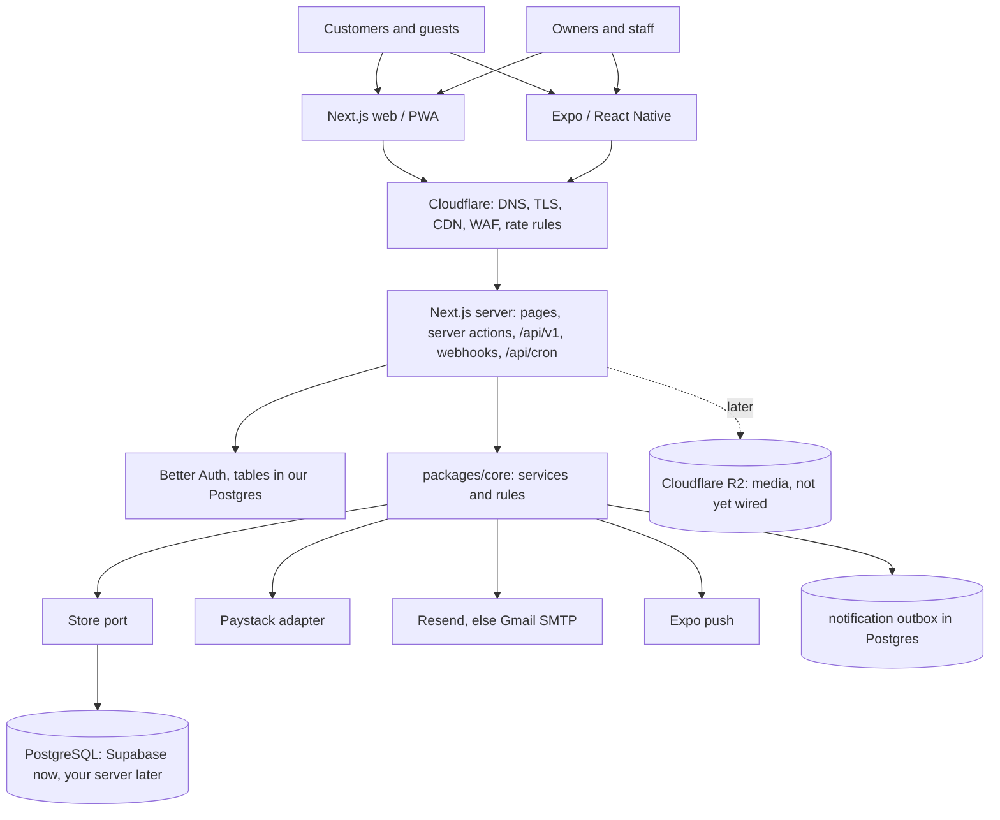

# System overview

**Status:** describes what is built. Where the target blueprint differs, `module-boundaries.md` says how.

## Request lifecycle (a customer places an order)
1. Browser posts a server action. Rate limit checked (`order_create`).
2. `placeOrder` loads the business and **only that business's** active products, prices the cart on the server, checks the plan's order limit, the allowed payment methods and the made-to-order lead time.
3. `insertOrder` runs in one transaction: guest contact, order, items, stock reservation (one atomic UPDATE per item), payment row, guest-link hash.
4. Automatic payment: `initializeProviderCheckout` calls Paystack (no database transaction is held during that call) and redirects the customer. Manual payment: the order page shows the account number and the "I have transferred" button.
5. Paystack calls the webhook: signature checked on the raw body, duplicates dropped, payment re-verified with Paystack, amount and currency compared, state changes applied with compare-and-set, notifications queued.
6. After each successful action (and after the webhook) a non-blocking flush sends due emails and push notifications; `/api/cron` is the safety net for retries and reminders.

## Where truth lives
PostgreSQL is the source of truth for everything transactional. R2 will hold media objects (metadata in Postgres). Better Auth's tables are ours, inside the same database, so there is no separate identity system to migrate.
